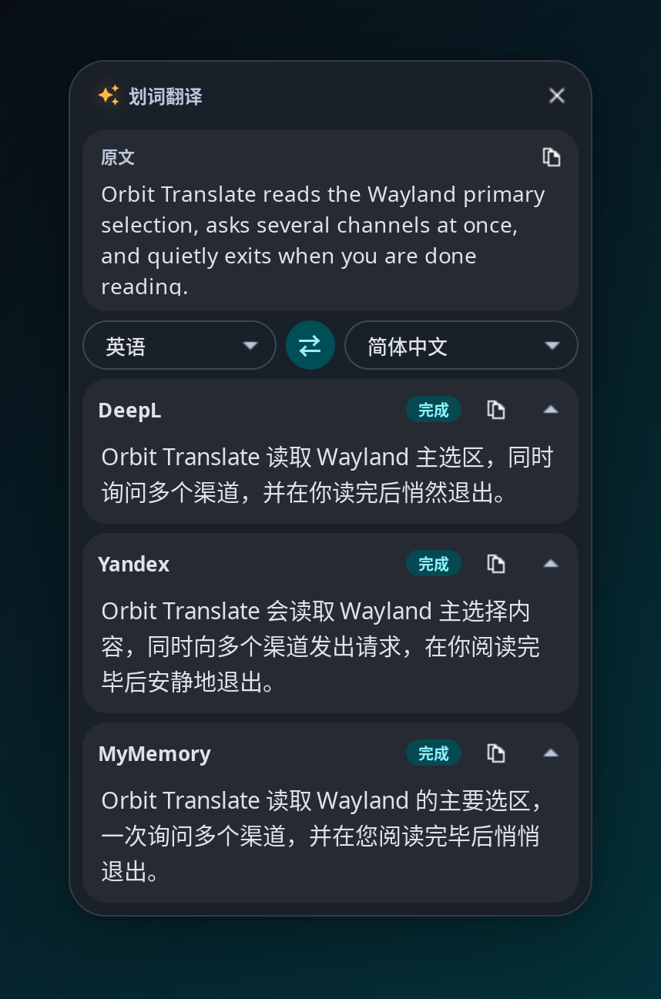
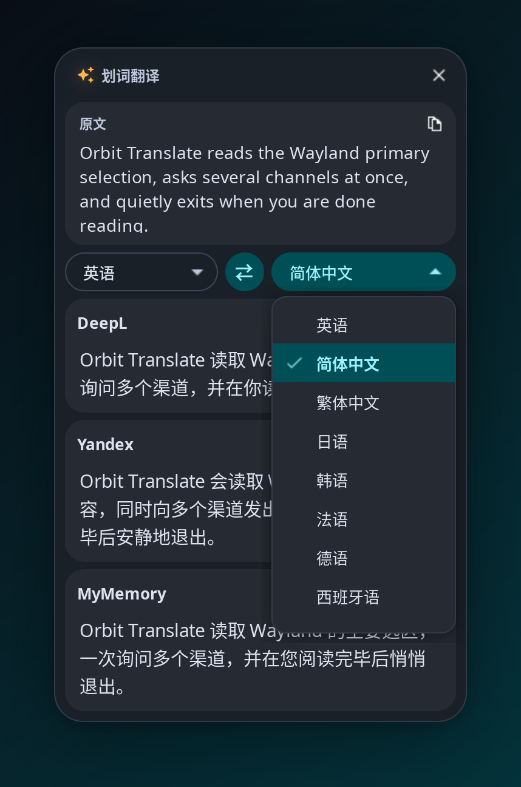
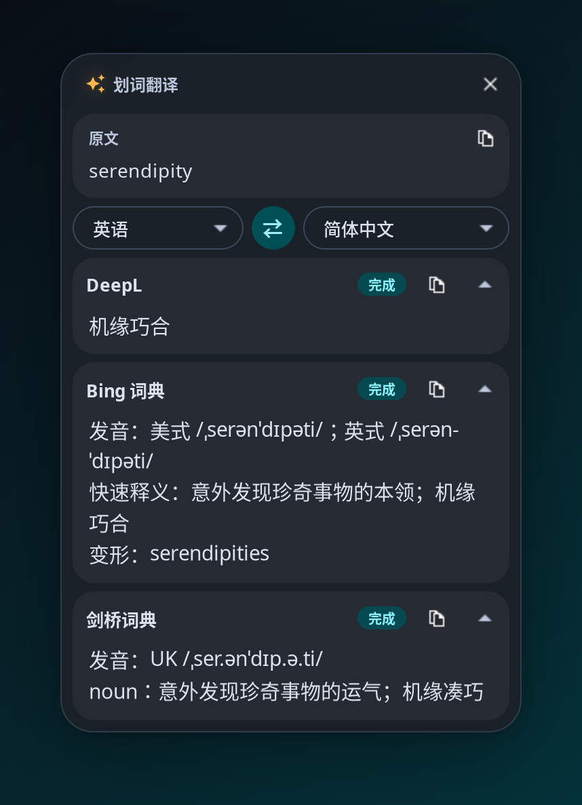
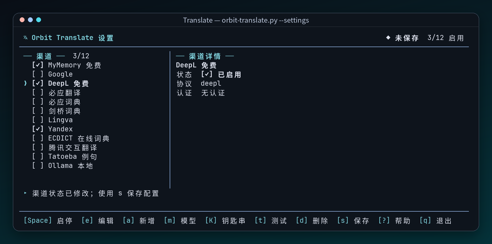
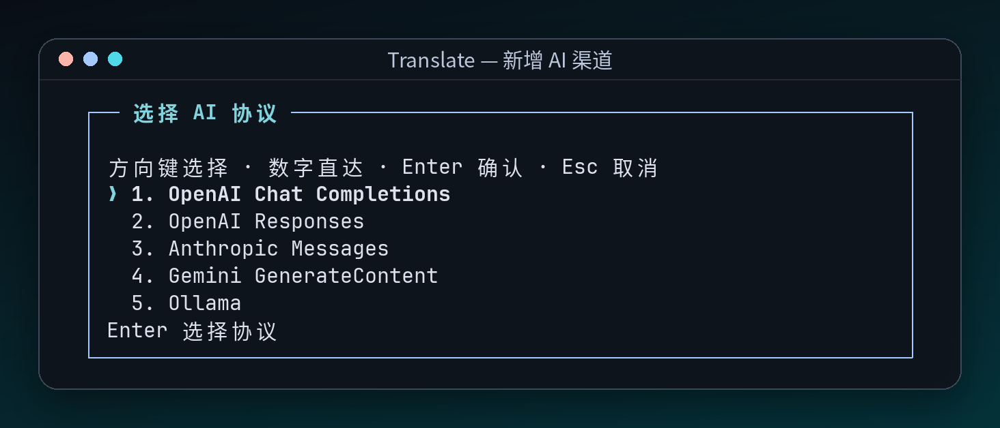

<a id="readme-top"></a>

<div align="right">
<a href="README.md">English</a> | <strong>简体中文</strong>
</div>

<div align="center">

<h1>Orbit Translate</h1>

<p><strong>Niri / Wayland 上的一次性划词翻译浮窗</strong><br />
<sub>选中、按键、看译文，然后它自己就走了（ゆっくりしていってね！）</sub></p>

<p>
<a href="https://github.com/WALKERKILLER/orbit-translate/stargazers"></a>
&nbsp;
<a href="https://www.python.org"></a>
&nbsp;
<a href="LICENSE"></a>
&nbsp;
<a href="https://github.com/WALKERKILLER/orbit-translate/actions/workflows/ci.yml"></a>
</p>

<p>

&nbsp;

&nbsp;

</p>
<p><sub>多渠道并行译文 · 目标语言菜单向下展开 · 单词查询：译文 + 词典卡片</sub></p>

<p>
<sub><em>来自 <a href="https://github.com/ech678/Nyxuri">Nyxuri</a> · 阅读 <a href="https://github.com/WALKERKILLER/orbit-translate/wiki/Home-zh">Wiki</a></em></sub>
</p>
<br />

</div>

> **说明**：Orbit Translate 原本是 [Nyxuri](https://github.com/ech678/Nyxuri) 里 Noctalia 的补充小工具，按 Nyxuri 路线图 R0-5 外迁成独立仓库。Nyxuri 用户什么都不用改，部署位置和快捷键都没变。

## Orbit Translate 是什么

选中一段文字，按下快捷键，指针下方就会弹出一个 Material 3 色调的小浮窗，同时问好几个翻译渠道。看完了它会自己消失。

**没有 daemon、没有托盘、没有翻译缓存。** 每次按键就是一个短命进程，读完 Wayland PRIMARY 选区、并行请求、展示结果、退出。

- **多渠道并行**：MyMemory、Google、DeepL、Bing、Yandex、Lingva、腾讯交互翻译；ECDICT、Bing / 剑桥词典；Tatoeba 例句；还有 Ollama、OpenAI / Anthropic / Gemini 协议和自建 LibreTranslate。公共接口的请求与解析对齐 Pot，除 MyMemory 外默认关着，按需开。
- **安静的反馈**：只展示成功的卡片，按渠道顺序排好；失败的不闪现，全军覆没才提示一句。
- **终端里配置**：`--settings` 打开 `curses` 设置界面，开关渠道、加 AI、按 `m` 从 models.dev 搜模型、示例测试、显式保存。
- **Key 不落盘**：TOML 拒绝明文 `api_key`，只认环境变量或 KWallet / Secret Service 里的引用。
- **跟着壁纸变色**：读 Nyxuri 的 Monet 调色板，没有就用内置色。
- **顺手的小细节**：指针下方空间不够就翻到上方；`Super + 左键`拖动、`Super + 右键`缩放；鼠标停留时不会自己关掉。

## 安装

运行时需要 Niri、`wl-clipboard`、GTK3、`gtk-layer-shell`，以及系统 Python（3.11+）的 PyGObject：

```bash
sudo pacman -S --needed python-gobject gtk3 gtk-layer-shell wl-clipboard
```

### Nyxuri 用户

装了 Nyxuri 并启用 Noctalia 插件就已经有了，按 `Alt + E` 即可。

### 独立安装

```bash
git clone --depth 1 https://github.com/WALKERKILLER/orbit-translate.git ~/orbit-translate
cd ~/orbit-translate && ./install.sh
```

程序装到 `~/.config/noctalia/tools/`。第一次会复制免费预设配置 `orbit-translate__custom__.toml`，之后重复运行只刷新程序文件，不碰你的配置。`./install.sh --uninstall` 删除程序、保留配置。

然后把快捷键加进 Niri 配置（比如 `~/.config/niri/__custom__.kdl`）：

```kdl
binds {
    Alt+E repeat=false hotkey-overlay-title="Translate selection" {
        spawn "~/.config/noctalia/tools/orbit-translate.py"
    }
}
```

## 目录结构

```text
orbit-translate
├── orbit-translate.py          # 入口：划词翻译 / --settings / --check-deps
├── orbit_translate/            # 程序本体（纯标准库 + GTK3）
├── config/                     # 用户配置模板（免费预设）
├── install.sh                  # 独立安装 / 卸载
├── scripts/                    # 开发脚本（效果图渲染）
├── assets/screenshots/         # README 与 Wiki 效果图
├── tests/                      # 契约测试（core / catalog / tui）
├── llms-wiki/                  # 架构契约与设计决策
└── humans-wiki/                # 用户手册（同步到 GitHub Wiki）
```

## 配置

```bash
~/.config/noctalia/tools/orbit-translate.py --settings
```

<table>
  <tr>
    <th width="60%">渠道设置 TUI</th>
    <th width="40%">新增 AI 渠道：协议选择</th>
  </tr>
  <tr>
    <td></td>
    <td></td>
  </tr>
  <tr>
    <td><sub>左列渠道、右列详情：<code>❯</code> 指针、<code>[✓]</code> 启停、底部 <code>[键] 操作</code> 提示，未保存状态显示在标题栏。</sub></td>
    <td><sub>OpenAI Chat / Responses、Anthropic、Gemini、Ollama 各自适配；按 <code>m</code> 从 models.dev 预填。</sub></td>
  </tr>
</table>

渠道开关、AI 协议、API Key 和 models.dev 快捷配置都在这里。字段说明见 [配置手册 (Wiki)](https://github.com/WALKERKILLER/orbit-translate/wiki/Configuration-zh)。

## 故障排除

先跑一下 `~/.config/noctalia/tools/orbit-translate.py --check-deps`。没有选中内容、没有结果或浮窗起不来，见 [故障排除指南 (Wiki)](https://github.com/WALKERKILLER/orbit-translate/wiki/Troubleshooting-zh)。

## 开发

```bash
python3 -m compileall -q orbit_translate orbit-translate.py tests
/usr/bin/python3 -m unittest discover -s tests -t .
shellcheck install.sh
```

改动路由、不变量和完成定义见 [AGENTS.md](AGENTS.md)，运行时契约见 [llms-wiki](llms-wiki/llms.txt)。

## 社区

**交流：** 问题反馈 [GitHub Issues](https://github.com/WALKERKILLER/orbit-translate/issues) · Nyxuri 桌面配置见 [ech678/Nyxuri](https://github.com/ech678/Nyxuri)

**感谢：**

* [Nyxuri](https://github.com/ech678/Nyxuri)（[@ech678](https://github.com/ech678)）——本工具的诞生地与视觉语言
* [Pot](https://github.com/pot-app/pot-desktop)——免费渠道的协议参考
* [models.dev](https://github.com/anomalyco/models.dev)——AI 提供商与模型目录（MIT）

本项目以 [GPL-3.0](LICENSE) 许可发布。

<p align="right">(<a href="#readme-top">回到顶部</a>)</p>
